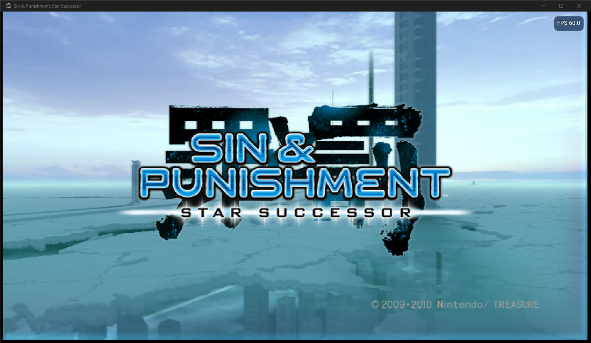
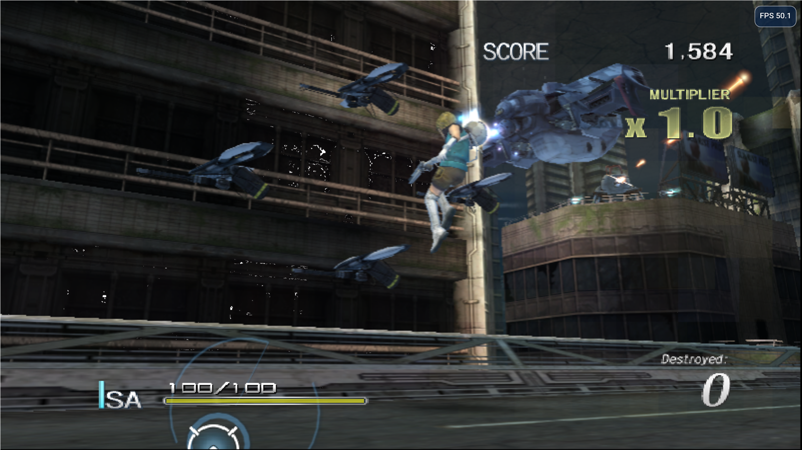
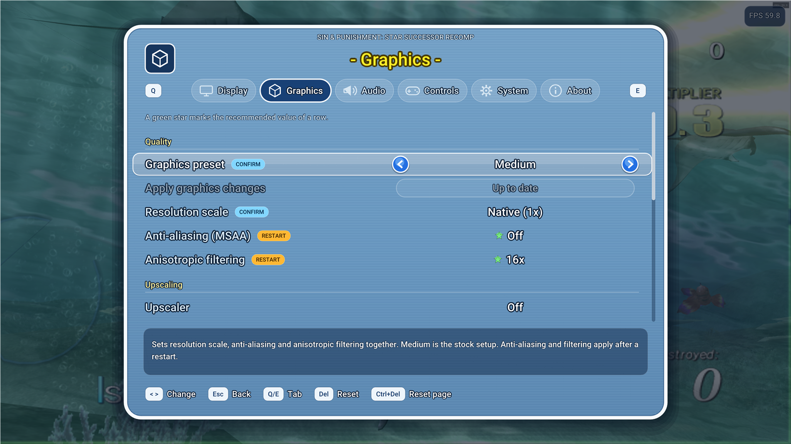

# Sin & Punishment: Star Successor Recomp

<p align="center">
  <a href="LICENSE"></a>
  
  
  
</p>

<p align="center">
  <a href="https://recomplauncher.com"><picture><source media="(prefers-color-scheme: dark)" srcset="https://recomplauncher.com/assets/press/launcher/badge-light.svg"></picture></a>
</p>

A native PC port of *Sin & Punishment: Star Successor* for Wii, made with static recompilation.

The PowerPC code from the game is translated to C++ ahead of time. The Wii OS, GX graphics, audio, input, DVD and NAND
interfaces are provided by a host runtime. There is no emulator, interpreter, JIT, or PowerPC CPU in the runtime loop.

> [!IMPORTANT]
> This repository contains no Nintendo code, no game data, no extracted assets, and no compiled game binary. You must
> provide your own legally dumped copy of **Sin & Punishment: Star Successor**, NTSC-U (`R2VE01`).

## How to play

Open `WiiCompiled.exe` and choose **Select Disc Image**. Pick your NTSC-U `R2VE01` image
(ISO, WBFS, RVZ or GCZ), then your own raw 16-byte Wii common key file. For RVZ or GCZ,
select an installed [DolphinTool.exe](https://github.com/dolphin-emu/dolphin#dolphintool-usage)
when prompted. The app imports the disc once and never copies the key into its data folder.

In RecompLauncher, an extracted `sys/` and `files/` folder needs no key. Before starting
RecompLauncher for disc-image setup, set `SIN_WII_KEY_FILE` to the full path to your key file.
RVZ and GCZ also need `SIN_DOLPHIN_TOOL` set to the full path to your installed DolphinTool.exe,
when that launcher build offers the format. These are paths to files you already have.

<p align="center">
  
</p>

## Current status

The project is in active gameplay testing:

- boots to the rendered title screen;
- all eight stage modules load and render;
- deterministic `A -> B -> A` module swaps pass;
- guest Wii Remote, Nunchuk and Classic Controller handshakes run;
- gamepad, keyboard and mouse input are implemented;
- the title and pause menus open the recomp settings overlay;
- audio produces non-silent mixed PCM;
- saves are created through the NAND HLE path;
- the release package builds and boots without bundled game data.

A full human playthrough, physical-device acceptance, audible-output testing and save/quit/reload validation remain open.
See [the current remaining work](docs/REMAINING.md) and [the full completion plan](docs/COMPLETION-PLAN.md).

<p align="center">
  
</p>

## Features

### Native runtime

- Ahead-of-time PowerPC-to-C++ translation.
- Static translation of the main DOL and all eight stage RSO modules.
- Native Aurora/GX rendering through WebGPU/D3D12/Vulkan-compatible backends.
- DVD and NAND high-level emulation against a locally extracted disc.
- Native SDL audio output, threaded AX/DSP mixing and Wii timing behavior.

### Controls

The one intentional gameplay change is modern controller support:

- left stick: Nunchuk movement;
- right stick: Wii Remote pointer aiming;
- optional calibrated controller gyro aiming with player-space axes, sensitivity, inversion and hold-to-aim/pause ([setup](docs/GYRO-AIMING.md));
- normal gamepad triggers, bumpers and face buttons;
- absolute or relative mouse aiming;
- keyboard/mouse bindings;
- virtual Wii Remote + Nunchuk and experimental Classic Controller paths;
- remappable controls with a controller-first in-game setup UI.

### Display and graphics

- Native, 1.5x, 2x, 3x and 4x internal rendering.
- Optional FSR 1 spatial upscaling and NVIDIA DLSS where available.
- Original 60 Hz mode, match-display mode and interpolated presentation.
- VRR/G-SYNC/FreeSync support.
- Game-styled Display, Graphics, Audio, Controls, System and About pages.
- Settings are staged until **Apply and confirm** is selected, followed by a single Keep/Revert safety prompt.
- HUD/GUI/text is recomposited after 3D upscaling with nearest-neighbor sampling.

<p align="center">
  
</p>

## Requirements

See [Linux](docs/LINUX.md) and [macOS](docs/MACOS.md) for platform validation and build guidance.
The release instructions below currently describe Windows.

- Windows 10 or 11, 64-bit.
- A D3D12/Vulkan-capable GPU.
- .NET 8 SDK, CMake, Ninja and a 64-bit Clang/LLVM toolchain for building from source.
- Your own legally dumped **NTSC-U R2VE01** disc, extracted into a folder containing `sys/` and `files/`.

> [!NOTE]
> This project does not provide or link to game data. Do not redistribute Nintendo code or assets.

## Running

Without RecompLauncher, the executable can use an extracted disc folder configured in
`%LOCALAPPDATA%/WiiCompiled/Config.toml` (`UserData/Config.toml` beside a portable installation):

```toml
[paths]
dvd_root = 'D:/path/to/R2VE01'
```

Run `WiiCompiled.exe`. On first launch, the runtime creates its NAND save tree under the same data folder.

The launcher's `--data` option moves all mutable state to one directory. A selected extracted folder or disc image
can be passed directly with `--game`:

```powershell
WiiCompiled.exe --prepare --data C:\Games\SinRecompData --game D:\Dumps\Sin-R2VE01.iso --keys D:\Private\wii-common-key.bin
WiiCompiled.exe --data C:\Games\SinRecompData --game D:\Dumps\Sin-R2VE01.iso
```

`--prepare` is windowless, prints RecompLauncher progress lines, and accepts the same extracted folder or
disc images used by the interactive first-run importer. Pass `--dolphin-tool <exe>` for RVZ/GCZ
if it is not already configured. Conversion needs temporary disk space for a full ISO.

## Building

Build the translator:

```powershell
dotnet build translator/Translator.sln -c Release
```

Run the data-free translator suite:

```powershell
dotnet test translator
```

Generate the translated source and build graph:

```powershell
$t = 'translator/src/Translator.Cli/bin/Release/net8.0/Translator.Cli.dll'
dotnet $t emit-native-index --project projects/r2ve01/recomp.yml --out runtime/native-index.json
dotnet $t translate-recursive 0x80006310 --project projects/r2ve01/recomp.yml --threads 12 --output-metadata generated/base_translation_output.json
dotnet $t generate-data-init --project projects/r2ve01/recomp.yml
dotnet $t emit-build-shards --project projects/r2ve01/recomp.yml
powershell -File tools\clean_build.ps1 -Keep
```

The eight stage modules are pre-linked and translated separately. The exact commands and expected evidence are documented
in [`docs/STATUS.md`](docs/STATUS.md).

## RecompLauncher release package

After building the translated runtime and refreshing `ready\`, create the Windows release archive with:

```powershell
powershell -File tools\update_ready.ps1 -NoDlss
powershell -File tools\package_recomplauncher.ps1 -Version 1.0.0
```

The package script removes standalone mutable state and disc-derived stage modules, verifies the executable, runtime files and
`recomplauncher.json`, then writes
`dist\SinAndPunishmentRecomp-1.0.0-Windows-x64.zip`. No `UserData`, `recompdata`, disc image, or extracted game
files are included. Tag the GitHub release and attach that ZIP; GitHub source archives should be named with
`-source` if they are uploaded separately.

Setup generates all eight stage-module images from the player's copy. Extracted-folder users must run
`--prepare` once before playing a launcher release. The current integration checks and outstanding release
limitations are recorded in [the launcher audit](docs/RECOMPLAUNCHER-AUDIT.md).

## Controls

The default control scheme is pointer mode:

| Xbox-style input | Action |
|---|---|
| Left stick | Move |
| Right stick / mouse | Aim |
| RB | Shoot / sword |
| RT | Lock-on |
| LB | Jump |
| LT | Evade |
| Start | Pause |

Classic Controller emulation is available as an experimental option. Open the in-game settings from the game's title
or pause **OPTIONS** page; everything is remappable.

## Layout

| Path | Contents |
|---|---|
| `translator/` | PowerPC-to-C++ translator and tests |
| `projects/r2ve01/` | Main DOL and stage-module translation manifests |
| `runtime/` | Guest ABI, OS/GX/audio/input/storage HLE and settings UI |
| `aurora-main/` | Native GameCube/Wii rendering and platform backend |
| `tools/` | Translation, QA, capture, profiling and release helpers |
| `docs/` | Status, completion plan, notes and evidence summaries |
| `orig/`, `generated/`, `build/` | Ignored local disc, generated and build output |

## FAQ

**Is this an emulator?**
No. The guest PowerPC code is translated to native C++ before launch.

**Does this repository contain the game?**
No. You must legally own and dump the disc yourself.

**Is it complete?**
Not yet. All stages render and the core runtime is playable, but the final human playthrough, physical-controller
acceptance, audible-output and save/quit/reload gates remain open.

**Why is generated output not committed?**
Translation depends on the user's local disc. Ignoring generated code and local assets keeps copyrighted game data out of
the repository and keeps builds reproducible from each owner's inputs.

## AI usage

AI-assisted coding tools were used during development. Generated code and runtime behavior are validated with automated
tests, structured QA runs, screenshots and guest traces. Remaining human-only acceptance work is listed explicitly rather
than inferred from compilation.

## Credits

- The runtime and translator originated from [WiiCompiled](https://github.com/patchzyy/Wiicompiled).
- [Aurora](https://github.com/encounter/aurora) provides the GX rendering/windowing backend.
- [Dawn](https://dawn.googlesource.com/dawn) provides WebGPU.
- [Dolphin Emulator](https://github.com/dolphin-emu/dolphin) is used as a reference for Wii hardware behavior.
- The static-recompilation community and upstream open-source core contributors.

Bundled third-party components retain their original licenses.

## License

This project is licensed under the [GNU General Public License, version 3](LICENSE).

Not affiliated with, endorsed by, or associated with Nintendo or Treasure. Sin & Punishment: Star Successor is a trademark
of its respective rights holders. No Nintendo intellectual property is contained in, distributed with, or obtainable from
this repository.
