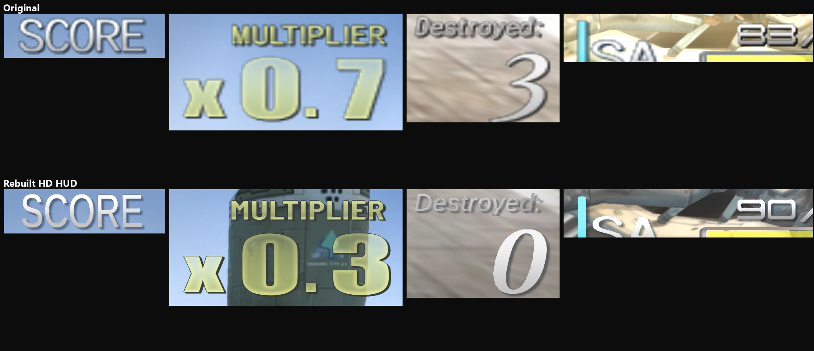
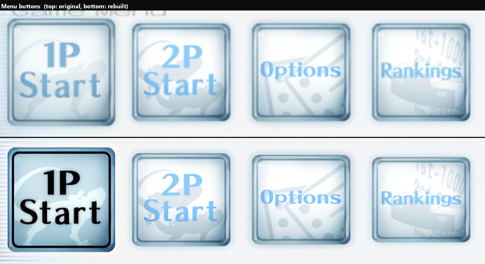
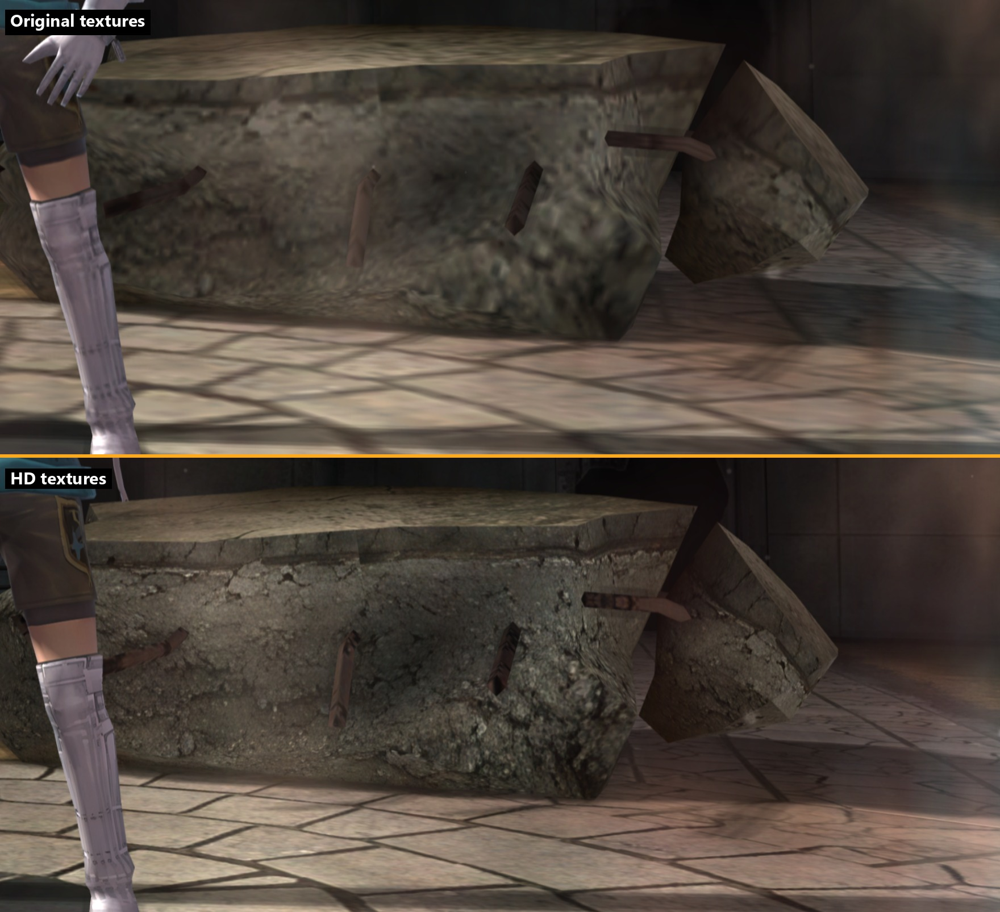
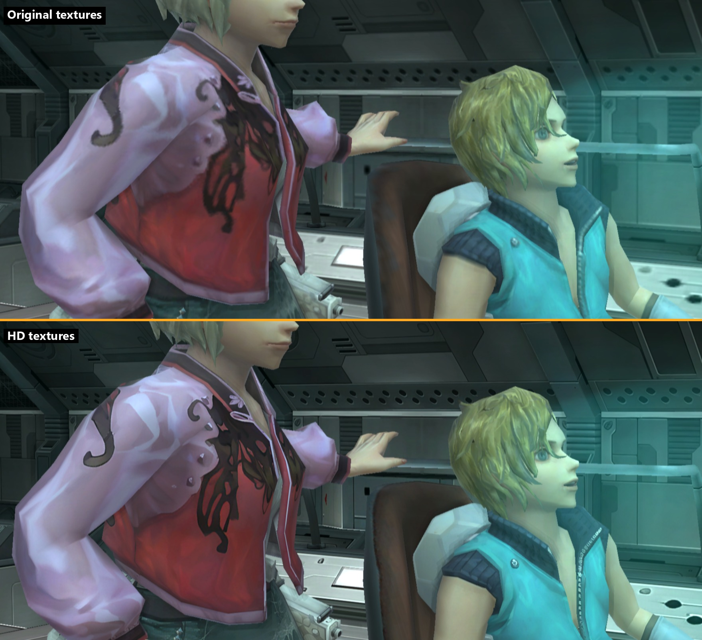
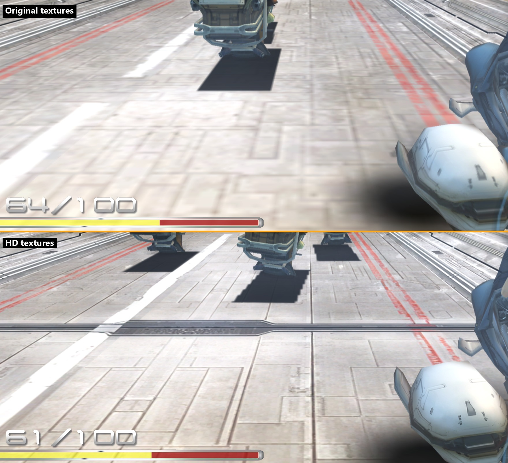
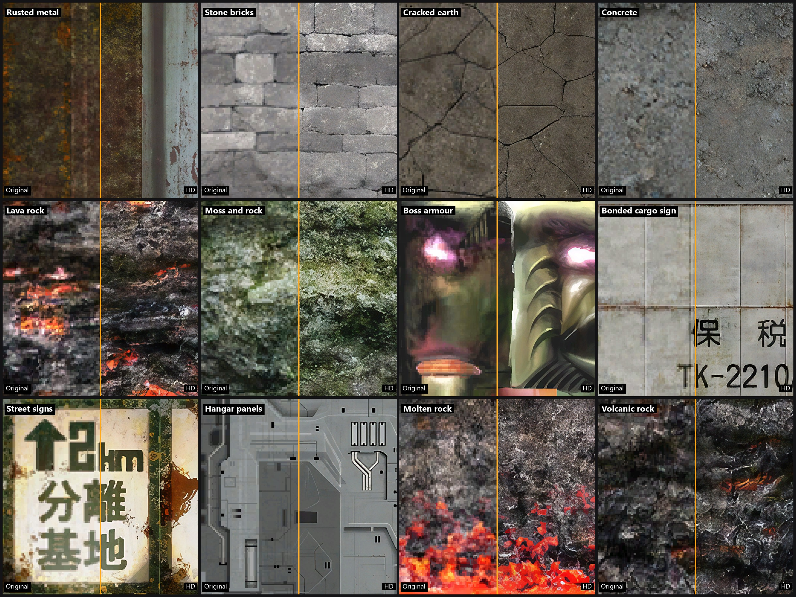

# Sin & Punishment: Star Successor Recompiled

A native PC port of Treasure's Wii rail shooter. Run the original campaign with mouse, dual-stick, or gyro aiming, and choose how the game renders on your display.

**Windows x64 · Native PowerPC recompilation · In testing · [GPL-3.0](LICENSE)**

[Getting started](#getting-started) · [Features](#features) · [HD textures](#hd-world-textures) · [Enhanced local co-op](#enhanced-local-co-op) · [Controls](#controls) · [Project status](#project-status) · [Building from source](#building-from-source)

<p align="center">
  
</p>

> [!IMPORTANT]
> Bring your own Wii copy of **Sin & Punishment: Star Successor** (North America, `R2VE01`) or **Tsumi to Batsu: Sora no Koukeisha** (Japan, `R2VJ01`). The project does not supply the game disc, extracted game files, or disc keys.

## Features

- **Modern aiming.** Use a mouse or right stick to aim while moving with the left stick or WASD. Controllers with a supported motion sensor can use [calibrated gyro aiming](https://github.com/meathax/sinandpun/blob/b67b4cd944c43d2ffefa3d73cbbf686a36e4d1a9/docs/GYRO-AIMING.md).
- **Remappable controls.** Configure gamepad and keyboard/mouse bindings in-game. The port supports Wii Remote + Nunchuk and Classic Controller input schemes.
- **High-resolution rendering.** Render at window size or choose an internal resolution multiplier. The Windows release includes AMD temporal FSR, FSR 1 spatial upscaling, NVIDIA DLSS and DLAA on RTX systems, and 4× MSAA. See the [FSR notes](https://github.com/meathax/sinandpun/blob/b67b4cd944c43d2ffefa3d73cbbf686a36e4d1a9/docs/FSR-NOTES.md) and [DLSS notes](https://github.com/meathax/sinandpun/blob/b67b4cd944c43d2ffefa3d73cbbf686a36e4d1a9/docs/DLSS-NOTES.md).
- **Readable HUD.** Eligible Wii HUD and text draws are rendered over the upscaled scene at output resolution using the original textures and blending. Integer presentation can keep display pixels evenly sized when the source fits the selected aspect ratio.
- **4K HUD and text.** A rebuilt high-resolution HUD pack ships with the game: reticles, score and health digits, labels, subtitles, menus, the title logo and 4× button prompts. Toggle it in **Options → Graphics → HD HUD and text** (on by default).
- **HD world and character textures.** 292 remastered environment, object and character textures (up to 4× the original resolution) ship with the game. Toggle them in **Options → Graphics → HD world and character textures** (on by default). See [HD world textures](#hd-world-textures).
- **Flexible frame pacing.** Choose original 60 Hz, match-display, or interpolated presentation. Variable refresh rate is available on compatible displays.
- **In-game settings.** Open the game's **Options** from the title or pause menu. Display changes offer a Keep/Revert prompt.

## Enhancements

Open **Options → Enhancements** to choose the effects you want.

- **Bounce lighting.** Screen-space or ray-traced global illumination lets nearby surfaces pick up each other's color. Ray tracing can retain scenery that has moved out of view, so it can still contribute light.
- **Materials and combat lighting.** Glossy armor catches reflections, shot impacts and explosions briefly light nearby surfaces, and contact shadows ground characters in the scene.
- **Stage atmosphere.** Moving patterns of light play across underwater surfaces in Stage 2. Distance haze gives the scenery in Stage 5 more depth.
- **High-refresh presentation.** On supported NVIDIA hardware, D3D12 frame generation adds intermediate frames for smoother motion, with Reflex to manage latency.

## 4K HUD

Every 2D HUD and menu texture the game draws has been rebuilt at high resolution, so text and reticles stay sharp at 4K instead of being stretched from 480p. Text is retypeset with a fitted font and the original colours and shadows; thin digits and reticles are redrawn as clean vector shapes; menu art is AI-upscaled. Turning the option off restores the original art instantly, and a user `texture_replacements/` pack takes priority.

| Original (top) vs rebuilt (bottom), in-game at 4K |
| --- |
|  |
|  |

## HD world textures

The game's 3D surfaces were authored for a 480p Wii display, mostly as 128×128 and 256×256 textures that turn into blurry smears at 1440p and 4K. The release includes 292 of them rebuilt at 2× or 4× resolution: stone, concrete, rock, metal, roads, signage, ship interiors, characters' clothing and bosses. Each was upscaled with an AI model trained for game textures, then colour-locked to the original so the tone and art direction stay exactly as Treasure painted them. Effects, glows and the sky are left untouched.

The pack is on by default. Turn it off in **Options → Graphics → HD world and character textures** to compare. The change applies immediately, with no restart. A user `texture_replacements/` pack still takes priority. The pack adds about 350 MB on disk and about the same in video memory when every texture is loaded.

**In-game at 4K, 1:1 crops (same frame, original textures on top, HD textures below):**

| Stage 1: concrete slab and paving |
| --- |
|  |

| Opening: character clothing |
| --- |
|  |

| Stage 5: highway surface |
| --- |
|  |

**Texture close-ups (left half original, right half HD, same region):**



## Getting started

Windows 10 or 11 (64-bit) and a Direct3D 12 or Vulkan-capable GPU are required for the Windows build. See the separate [Linux](https://github.com/meathax/sinandpun/blob/b67b4cd944c43d2ffefa3d73cbbf686a36e4d1a9/docs/LINUX.md) and [macOS](https://github.com/meathax/sinandpun/blob/b67b4cd944c43d2ffefa3d73cbbf686a36e4d1a9/docs/MACOS.md) notes for build and validation status.

1. See [GitHub Releases](https://github.com/meathax/sinandpun/releases) for published builds, or [build it from source](#building-from-source).
2. Extract the entire Windows ZIP. Run `sinandpun.exe` for the North American version or `sinandpun-jp.exe` for the Japanese version.
3. Setup finds the game automatically when it sits next to the executable or in a `rom`/`roms` folder. Otherwise choose **Select disc image** for an R2VE01 or R2VJ01 ISO, WBFS, RVZ, WIA, CHD, CISO, GCZ or CUE/BIN. Setup asks for a key only when the game partition needs one and none nearby unlocks it. For an extracted game, choose **Select extracted folder** and select the parent folder containing both `sys/` and `files/`. Keep that folder in place after setup. It needs no key.

Keys are found by content and verified against the disc: a 16-byte key, BootMii `keys.bin`, `otp.bin`, any text containing the key, small dumps, 7z/zip/rar archives of those, or an RVZ of the same disc. Labels and file names do not matter. When nothing matches, setup explains what each file was and why it did not help. WAD channel packages do not supply this game's disc contents.

The importer prepares the stage modules on first setup and leaves the key out of the game data folder. See [Wii setup](https://github.com/meathax/sinandpun/blob/b67b4cd944c43d2ffefa3d73cbbf686a36e4d1a9/docs/WII-SETUP.md) for supported inputs and command-line examples.

### Japanese version (R2VJ01)

Version 1.0.11 adds the Japanese release. `sinandpun-jp.exe` runs it with its own game folder (`Game-R2VJ01`), console settings and saves, so both versions can be installed side by side. Choosing a Japanese disc in `sinandpun.exe`, or passing one with `--game`, hands it to `sinandpun-jp.exe` automatically. The Japanese version keeps its original Japanese HUD and text; the HD HUD pack (retypeset English art), the scene-glow toggle and Enhanced co-op are USA-only and appear disabled in its menu. The HD world texture pack, graphics enhancements and controls work in both.

### RecompLauncher

The repository includes a [RecompLauncher manifest](recomplauncher.json). For launcher-managed disc-image import, set `SIN_WII_KEY_FILE` to your key file path before opening [RecompLauncher](https://recomplauncher.com/). The [launcher integration notes](https://github.com/meathax/sinandpun/blob/b67b4cd944c43d2ffefa3d73cbbf686a36e4d1a9/docs/RECOMPLAUNCHER-AUDIT.md) explain packaging and validation.

## Enhanced local co-op

In **Enhanced** mode, Player 1 picks Isa or Kachi as usual. Player 2 gets the other character and can move, aim, shoot, slash, and evade independently. The partner flies in when control becomes available and flies out for scripted sequences. **Original** mode keeps the Wii's assist-fire controls for Player 2.

Both characters draw from **one health bar with 50% more base HP**. Standard characters share 150 HP. A hit on either player draws from that pool, and retrying a checkpoint does not stack the bonus.

1. From the title or pause menu, open **Options → Local Co-op** and set **Co-op mode** to **Enhanced**.
2. Choose **Player 2 input**. For two gamepads, select **Gamepad** and assign one controller to each player. For a mixed setup, select **Keyboard & Mouse** to give it to Player 2, or select **Gamepad** to leave keyboard and mouse with Player 1. Selecting the other player's controller swaps the assignments.
3. Restart the game after changing the mode or Player 2 input source.

## Controls

| Action | Xbox-style controller | Keyboard and mouse |
| --- | --- | --- |
| Move | Left stick | WASD |
| Aim | Right stick | Mouse or arrow keys |
| Shoot (hold) / slash (tap) | RT | Left mouse button or J |
| Lock on (tap) / charge (hold) | LT | Right mouse button or K |
| Jump | LB | Space |
| Evade | RB | Left Shift |
| Pause | Menu | Escape or P |

See [Modern controls](https://github.com/meathax/sinandpun/blob/b67b4cd944c43d2ffefa3d73cbbf686a36e4d1a9/docs/MODERN-CONTROLS.md) for the full layout, precision aim, recentering, and rebinding.

## Screenshots

| Title screen | In-game graphics settings |
| --- | --- |
|  |  |

## Project status

All eight stages have rendered in Windows testing at **1080p, 1440p, and 4K** with FSR and DLSS. This coverage includes sampled gameplay and stage transitions. A complete human playthrough, additional physical controller and audio checks, and cross-monitor DPI changes remain open.

See the [status notes](https://github.com/meathax/sinandpun/blob/b67b4cd944c43d2ffefa3d73cbbf686a36e4d1a9/docs/STATUS.md), [remaining work](https://github.com/meathax/sinandpun/blob/b67b4cd944c43d2ffefa3d73cbbf686a36e4d1a9/docs/REMAINING.md), and [completion plan](https://github.com/meathax/sinandpun/blob/b67b4cd944c43d2ffefa3d73cbbf686a36e4d1a9/docs/COMPLETION-PLAN.md). When reporting an issue, include your build or commit, GPU and graphics backend, stage, resolution, and upscaler settings.

## Building from source

The original Wii PowerPC code is translated to C++ ahead of time. The host runtime provides GX graphics, audio, input, DVD access, and NAND storage. You need your own extracted `R2VE01` (or `R2VJ01`) copy, .NET 8 SDK, CMake, Ninja, and a supported 64-bit Clang/LLVM toolchain.

```powershell
dotnet build translator/Translator.sln -c Release
dotnet test translator

$t = 'translator/src/Translator.Cli/bin/Release/net8.0/Translator.Cli.dll'
dotnet $t emit-native-index --project projects/r2ve01/recomp.yml --out runtime/native-index.json
dotnet $t translate-recursive 0x80006310 --project projects/r2ve01/recomp.yml --threads 12 --output-metadata generated/base_translation_output.json
dotnet $t generate-data-init --project projects/r2ve01/recomp.yml
dotnet $t emit-build-shards --project projects/r2ve01/recomp.yml
powershell -File tools\clean_build.ps1 -Keep
```

The Japanese build uses `projects/r2vj01/recomp.yml` (entry point `0x800062F0`, output `generated-jp`) and a separate CMake build directory configured with `-DMKW_GENERATED_DIR=<repo>/generated-jp`; package it as `sinandpun-jp.exe` with `tools/package_recomplauncher.ps1 -JapanBuildDirectory`. Run `python tools/check_region_map.py` after changing `runtime/include/guest_abi/guest_versions.inc` or either project's hook lists.

For stage-module generation, validation, and packaging, see [Build status](https://github.com/meathax/sinandpun/blob/b67b4cd944c43d2ffefa3d73cbbf686a36e4d1a9/docs/STATUS.md) and the [RecompLauncher audit](https://github.com/meathax/sinandpun/blob/b67b4cd944c43d2ffefa3d73cbbf686a36e4d1a9/docs/RECOMPLAUNCHER-AUDIT.md). Generated translations and local game data stay out of Git.

## Credits and license

The runtime and translator originated from [WiiCompiled](https://github.com/patchzyy/Wiicompiled). The port uses [Aurora](https://github.com/encounter/aurora) for GX rendering and [Dawn](https://dawn.googlesource.com/dawn) for WebGPU. [Dolphin](https://github.com/dolphin-emu/dolphin) serves as a reference for Wii hardware behavior. Thanks to the upstream contributors and the static recompilation community.

AI-assisted coding tools were used during development. The project uses automated tests, guest traces, and gameplay captures to check behavior.

Project source is licensed under the [GNU General Public License, version 3](LICENSE). Third-party components retain their own licenses. This is an unofficial fan project and is unaffiliated with Nintendo or Treasure.
